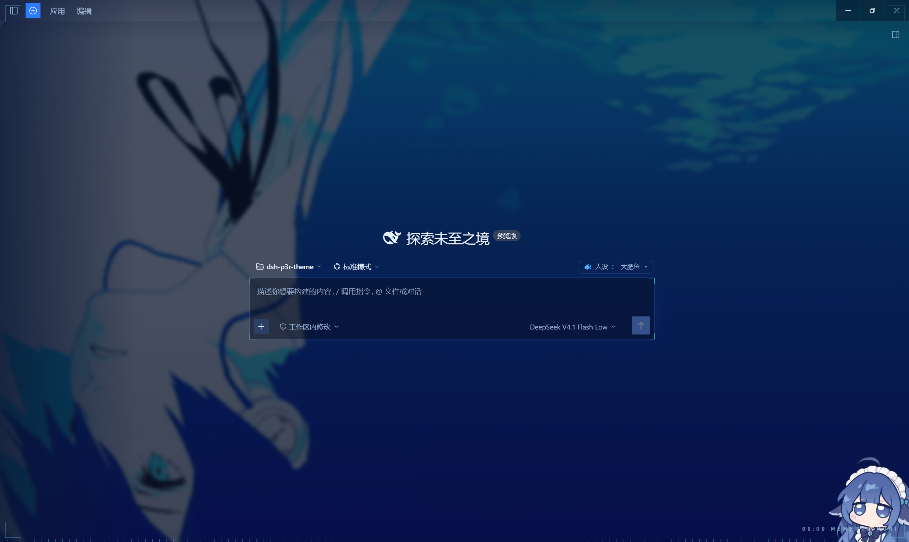

# dsh-theme-p3r

粉丝向的 Persona 3 Reload 风格的 DeepSeek Harness 桌面版主题插件喵。

深色模式和浅色模式的效果不一样喵，个人建议使用深色模式观感更佳喵

深海蓝做底，电光蓝和青色细线做骨，底边一条 HUD 时间刻度、右下角 `00:00 · MEMENTO MORI`。
对话按游戏里的方式排版：**你说话是白底蓝字的框，模型说话是蓝底白字的框**。
亮色模式切成"白昼"：冰蓝纸面 + 白卡片 + 同一支蓝。

## 效果

| 部分 | 做法 |
| --- | --- |
| 全站配色 | `theme.overrideTokens` 覆盖 50 多个 `--dsw-alias-*` / `--dsw-specific-*` 令牌（亮/暗两套） |
| 中性色阶 | 整条 `--dsw-static-neutral-bluish-*` 从暖灰换成蓝灰，绕开令牌直接用色阶的组件也不会跑调 |
| 背景 | `li.gif` 内联为 data URI，轻模糊（2.5px）+ 提饱和；面板只留 **24% 不透明**（白昼 32%），水在整块界面里走得明明白白 |
| 水色 | 不靠 `brightness` 把图压黑（那会连水纹一起压死），而是盖一层**海军蓝染色**：保住波浪结构，整体归到午夜色 |
| 外框 | 四角青色括线，和输入框同一套瞄准语言，让桌面读起来像"游戏画面"而不是"带背景的网页" |
| 对话框 | 用户消息＝白底 `#f6faff` + 蓝字 `#0b3fa8` + 1px 蓝边 + 3px 蓝脊；模型回答＝`#1d54cc → #123a91` 蓝底 + 白字 + 青色脊线，框内链接、行内代码、代码块、表格逐项重配过色 |
| 几何 | 控件圆角归零，大面板 2px；1px 发丝线代替阴影 |
| 字体 | P3R 那种窄体工程黑：拉丁数字用 `Bahnschrift`（系统自带 DIN），中文落到 `MiSans` / `Noto Sans SC`；两者都改 `--dsw-font-family`，连应用自己印的标签一起换 |
| 排版 | 不用斜体（那是 P5），靠字重与字距；小标签全大写 + 0.22em 字距，前置一段 14px 细线 |
| 选中框 | 菜单项 / 选项 / 侧栏条目被预选时，滑进一块 **斜切 13° 的蓝色平行四边形**：左侧亮青脊线、1px 青边、细斜纹，静止时缓慢左右浮动 |
| 交互 | 悬停淡蓝底 + 内发光描边、选中项 2px 青色竖脊、青色焦点环、蓝底白字选区 |
| 输入框 | 四角青色瞄准括线（八段零模糊渐变画的，不加元素） |
| 彩蛋 | 顶部 1px 扫描线；底边时间刻度（中间被遮掉，不压输入框） |

亮 / 暗跟随系统或应用内的外观设置，无需手动切换。

## 安装

本地目录装（开发时用，改完刷新页面就生效）：

```bash
dsh plugin --profile desktop add /path/to/dsh-p3r-theme
```

但当前桌面版里 `desktop` profile 是**由 Electron 应用独占管理**的，`dsh plugin --profile desktop` 会被拒绝。所以直接在应用内装：
设置 → 插件 → 从本地目录安装，选这个文件夹。

装完要**重启应用**（不是刷新页面）：客户端脚本是新的一档，热刷新不会拉进来。

## 换背景图

把新的图覆盖成 `li.gif`（或 `li.webp` / `li.png`），然后：

```bash
npm run media      # = node tools/sync-media.mjs
```

`npm run media` 会把图 base64 后写进 `client.js` 里标记好的区块。
`node tools/sync-media.mjs --check` 可以检查有没有忘记同步。

图是 `background-size: cover` + 轻模糊，所以原图不用很大；但也别小于 800px 宽，会被放糊。

## 想自己调

改 `client.js` 顶部 `TOKENS` 里的值，或者直接在 `body[data-p3r]` 那一段调这几个变量：

| 变量 | 作用 |
| --- | --- |
| `--p3-blue` | 主蓝（按钮、链接） |
| `--p3-cyan` | 青光（细线、括线、选中脊） |
| `--p3-hud` | 底边时间刻度的颜色，调低就更安静 |
| `--dsw-alias-bg-base` | 面板不透明度，暗色 `rgba(10, 22, 46, 0.24)`、白昼 `rgba(215, 230, 249, 0.32)`；调高更实、调低背景更清楚 |
| `.p3r-water` 的 `brightness` | 水面亮度，暗色 `0.90`、白昼 `1.00`；想更亮往上加 |
| `body[data-p3r]::before` 的第三层 | 那层海军蓝染色，暗色 `0.26 → 0.30 → 0.42`（顶栏、中部、底部）；觉得水太吵就加厚它，别去动 `brightness` |
| `.p3r-frame` 的 `opacity` | 四角括线的存在感，暗色 `0.5`；不想要就把元素的那条规则删掉 |
| `--p3-cyan` 在选中板里 | 板的前缘脊线颜色 |

## 选中框怎么生效

只挂在真正"可以选择的行"上，不会跑到工具栏图标按钮上：

```
[role="menu"] [role="menuitem"]       弹出菜单项
[role="listbox"] [role="option"]      下拉选项
[role="tablist"] [role="tab"]         标签
[class*="_sessionRow"] / _projectRow / _panelRow   侧栏条目
```

触发条件是 `:hover`、`:focus-visible`、`aria-selected="true"`、`aria-current`、
`[data-highlighted]`，或类名里带 `_selected` / `_panelActive`。所以鼠标划过、
键盘方向键移动、以及"当前已选中"三种状态都能出框。

板子是行元素的 `::before`，`z-index: -1` 落在行自身背景之上、文字之下，
不需要改应用结构，也不会盖住文字。

## 对话框怎么生效

| 位置 | 选择器 | 外观 |
| --- | --- | --- |
| 你 | `[data-chat-flow-kind="user"] [class*="_bubble"]` | 白底、蓝字、蓝边框、左侧 3px 蓝脊 |
| 模型 | `[data-slot="conversation.chat.flow"] [class*="_markdown_"]` | 蓝底白字，青色左侧脊线 |

模型那半不套整行，只套正文（应用的 markdown 根节点），所以下方的复制 / 重试按钮仍然浮在水面上，
不会被卷进蓝框。框内的 `a`、`code`、`pre`、`li::marker`、`th/td` 都有单独的配色——
页面级令牌是按深色页面调的，直接放进蓝框里要么看不见（深蓝链接），要么太抢（纯白正文）。

## 已知限制

- **宿主那半层在这版桌面版里不激活。** 同一个 profile 里另一个主题的 `/theme-*/media/*` 路由在所有本地端口都是 404，所以这个主题不依赖自定义路由，图是内联的（代价是 `client.js` 有 2.4MB）。真要好起来只能等宿主层修。
- **GIF 无法用 CSS 暂停。** 系统开了"减少动态效果"时，直接把水层隐藏，只留下底层渐变，不硬扛。
- 底边刻度是 `position: fixed` 的一层，`z-index: 0`，只占 7px 高，且中间 24% 被遮罩挖空避开输入框。

# 效果图


